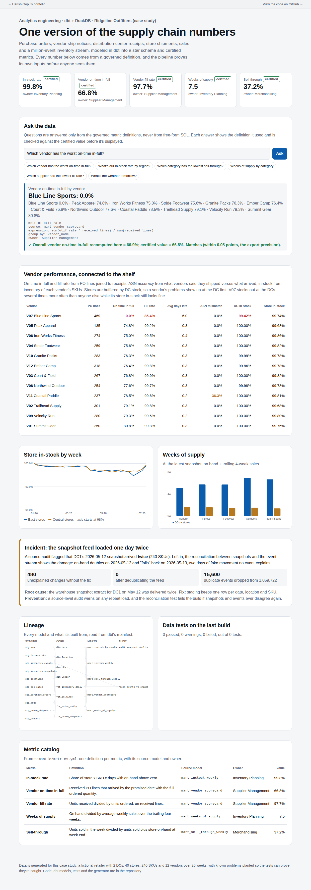

# Supply Chain Data Platform

An analytics-engineering platform for a fictional sporting goods retailer's supply chain, built in **dbt** on DuckDB. It takes purchase orders, vendor ship notices, distribution-center receipts, store shipments, point-of-sale sales and a million-event inventory stream, and turns them into a tested star schema, certified metrics, and a dashboard whose conversational answers are checked against those certified numbers.

**Live dashboard:** linked from the [portfolio hub](https://harish04010-portfolio.vercel.app).



## What's in it

| Layer | What it does | Where |
|---|---|---|
| **Sources** | Extracts shaped like a warehouse management system's: purchase orders, ASNs, DC receipts, store shipments, POS sales, daily inventory snapshots, and an inventory event stream with duplicates, late and out-of-order events | `generator/generate.py` |
| **Staging** | Types and cleans each source. Deduplicates the snapshot feed and the event stream (by `event_id`, first delivery wins, event time rather than ingestion time) | `models/staging/` |
| **Core** | Star schema: `dim_date`, `dim_sku`, `dim_location`, `dim_vendor`; `fct_po_lines` (PO + ASN + receipt, with on-time, in-full and OTIF flags), `fct_inventory_daily`, `fct_sales_daily`, `fct_store_shipments` | `models/core/` |
| **Marts** | Vendor scorecard, in-stock by week, weeks of supply, sell-through, and in-stock by vendor at DCs and stores | `models/marts/` |
| **Audits** | A source-level duplicate-load check, and a **source-to-target reconciliation** that rebuilds each day's inventory change from the event stream and compares it with the snapshots | `models/audit/` |
| **Governed metrics** | One definition per metric (expression, source model, grain, owner), used by the dashboard and the assistant | `semantic/metrics.yml` |
| **Tests** | 21 dbt tests (unique, not-null, relationships, accepted values and four custom tests), plus 8 Python tests on the built warehouse | `models/schema.yml`, `tests/`, `tests_py/` |

## Certified numbers

| Metric | Value | Owner |
|---|---|---|
| Store in-stock rate | 99.8% | Inventory Planning |
| Vendor on-time in-full | 66.8% | Supplier Management |
| Vendor fill rate | 97.7% | Supplier Management |
| Weeks of supply (DCs + stores) | 7.5 | Inventory Planning |
| Weekly sell-through | 37.2% | Merchandising |

## What the platform caught

- **A snapshot feed that loaded one day twice.** DC1's May 12 inventory arrived twice (480 rows for 240 SKUs). The source audit warns on it, and staging keeps one row per key. Left in, the reconciliation shows exactly 240 unexplained changes on May 12 and 240 on May 13: on-hand doubling, then "falling" back. After the fix, snapshots and events agree for every location, SKU and day.
- **A late, short-shipping vendor, visible at the DC before the shelf.** Vendor V07 is on time and in full on 0% of its lines, with a 85% fill rate. Stores are buffered by DC stock, so its store in-stock still looks normal (99.74%). At the DCs, though, its SKUs are in stock 99.42% of days, against 99.86%–100.00% for every other vendor. That's the early warning to raise before shelves go empty.
- **A vendor whose ship notices overstate.** V11's ASNs disagree with what actually arrived on 36% of its lines, against 0% for the others.
- **Stream duplicates and late events.** 15,600 duplicate deliveries removed from 1,059,722 events. 2.0% of events arrived six or more hours late; they're placed by event time.
- **A bug in my own metric definition.** The dashboard's assistant recomputes each answer and compares it with the certified value. It refused to answer a weeks-of-supply question because the two disagreed: 4.3 certified vs 8.6 recomputed. The mart has a DC row and a store row per category, both carrying the category's weekly sales rate, and the governed expression summed it twice, halving weeks of supply. The definition now counts the rate once, and a test pins it. It's the clearest argument for validating every generated answer against certified numbers.

## Ask the data

The assistant answers only from `semantic/metrics.yml`, never with free-form SQL. It maps a question to a governed metric and dimension, shows the definition it used (source model, expression, grouping and owner), then recomputes the overall value and checks it against the certified number before showing anything. Questions outside the certified metrics get a polite refusal, and answers are withheld on any mismatch beyond the export's rounding precision (0.05 points).

## Running it

```bash
pip install -r requirements.txt
python generator/generate.py               # ~250 MB of source extracts in data/raw (not committed)
dbt build --profiles-dir .                  # models + 21 tests; expect 1 warning: the planted duplicate load
pytest -q tests_py                          # 8 checks on the built warehouse
python scripts/export_site.py               # refresh site/data.json for the dashboard
dbt docs generate --profiles-dir .          # lineage and documentation site
```

The generator is seeded, so every run produces the same data and the same results.

## Notes

- **dbt with DuckDB** runs locally with no warehouse to provision. The same models run on Snowflake or Databricks by swapping the adapter and profile.
- **The governed metrics file** follows the shape of dbt's Semantic Layer (metric, expression, model, grain, owner) without requiring MetricFlow, which keeps the project light to run.
- **The data is generated** to look like a warehouse management system's extracts. Nothing here comes from a real retailer.
